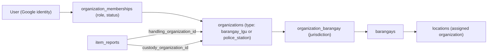
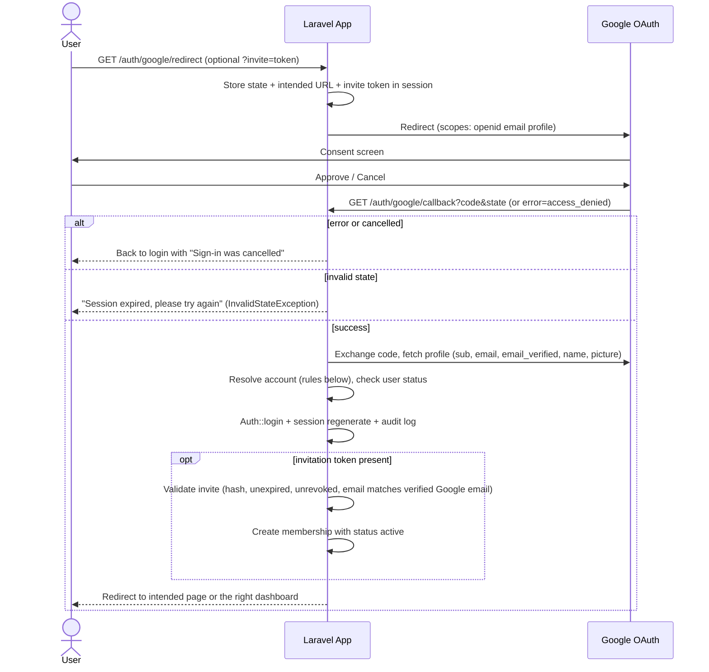
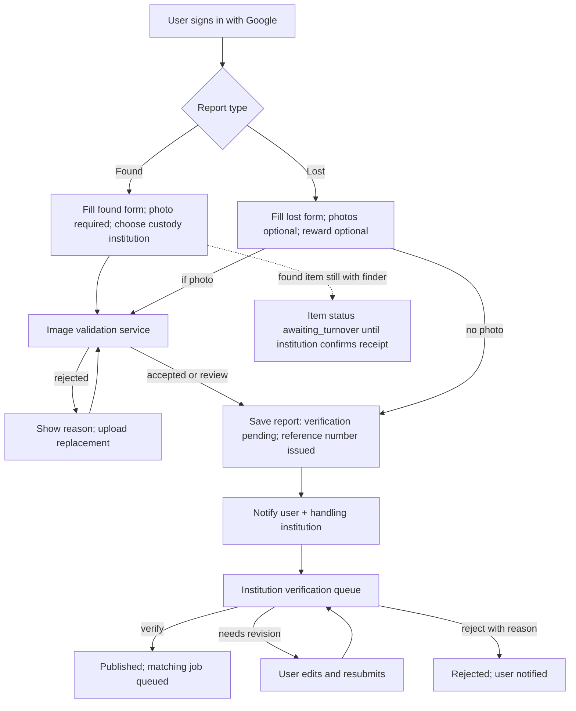
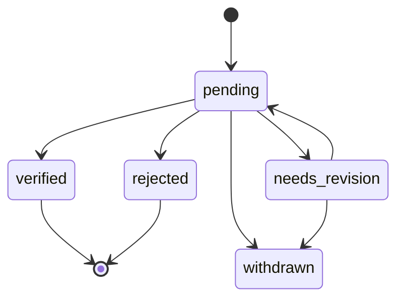
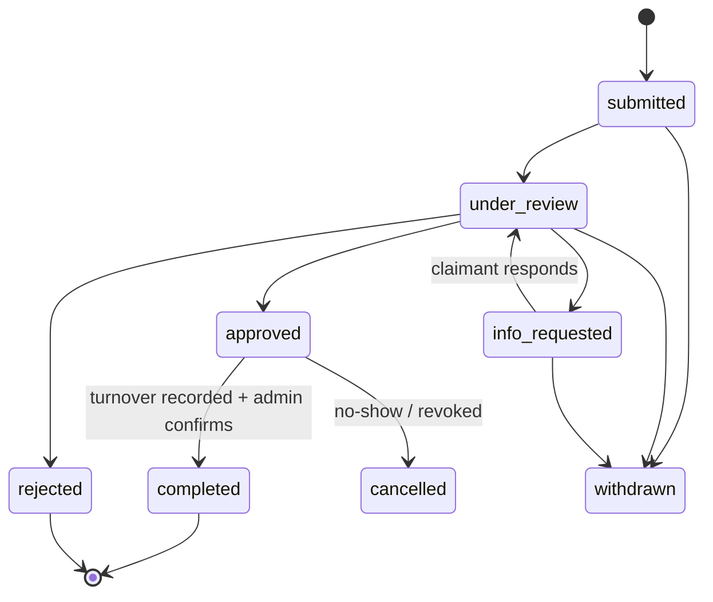
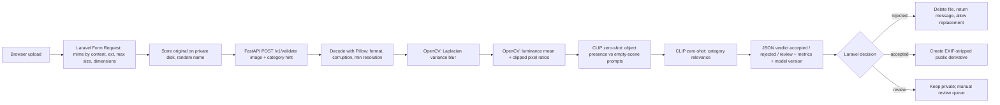

# Boracay Lost and Found System: The Reporting and Recovery of Lost Items
## Phase 1: Software Requirements Specification (SRS)

| Item | Value |
|---|---|
| Document | SRS v1.0 (Phase 1 deliverable) |
| Date | 2026-11-23 |
| Status | Approved 2026-11-23 (recommended defaults for U-01 to U-18 accepted) |
| Coverage | Boracay Island, Municipality of Malay, Aklan (Barangays Balabag, Manoc-Manoc, Yapak) |

> [!NOTE]
> **What's in the workspace now** (`c:\wamp64\www\boracay`): there's a fresh **Laravel 13.43** skeleton (PHP 8.3.14, Composer 2.8.9, Node 24.14). The `.env` currently points to **SQLite**. **MySQL 9.1.0** is installed under WAMP, which meets the MySQL 8+ requirement. Python is **3.14.3**. Only the default migrations are present. No application code was written in this phase.

---

## 1. Software Requirements Specification

### 1.1 Purpose
This document defines the requirements for a centralized, web-based lost and found platform that covers all of Boracay Island. Police stations and Barangay LGUs use it to receive, verify, match, return, and dispose of lost and found items. Residents and tourists use the public website to report and search.

### 1.2 Scope

**In scope:** these modules from Section D: public website, Google authentication, organization management, lost and found reporting, image validation, tracking, search, metadata matching, claims, verification, recovery, notifications (in-app and email), interface localization (EN/FIL), disposal monitoring, transaction history, dashboard, reports and exports (CSV/PDF), audit trail, and system settings.

**Conditional (needs separate approval):**
- Image-based matching (CLIP embeddings, `image_embeddings` table)
- Automatic translation of user-generated content (provider, cost, and privacy approval; `translations` table)
- SMS notifications

**Out of scope:**
- Payment or reward processing
- Delivery or transport of items
- Real-time GPS tracking
- Native mobile apps
- Paid AI services without approval
- SPA frameworks

### 1.3 Definitions
| Term | Meaning |
|---|---|
| Report | A lost report or a found report (`item_reports.type`) |
| Institution / Organization | An authorized Police Station or Barangay LGU |
| Custody institution | The organization physically holding a found item |
| Handling institution | The organization responsible for verifying a report |
| Match | A system-suggested pairing of a lost report and a found report, which an administrator must review |
| Claim | A request by a user to recover a specific found item |
| Recovery | The confirmed physical turnover of an item to a verified claimant |

### 1.4 Users and Context
| Actor | Description |
|---|---|
| Guest | Anyone without login. Can browse published records and public information |
| Public User | Signed in with Google (resident, tourist, finder, owner) |
| Institution Staff | Encodes and processes records for one institution |
| Institution Administrator | Verifies reports, decides claims, approves disposal, manages staff |
| Platform Super Administrator | Manages organizations, global settings, audit logs, system-wide analytics |
| Image Validation Service | Internal FastAPI service (no human user) |

### 1.5 Constraints
- Stack (mandatory): Laravel 13, Blade, Bootstrap 5.3, vanilla JS, MySQL 8+, Socialite, Chart.js, and a Python FastAPI/OpenCV service.
- One shared database for all organizations. Data is isolated by organization through authorization rules, not separate databases.
- Must follow the Philippine **Data Privacy Act of 2012 (RA 10173)** and its IRR.
- Physical item custody and disposal must follow the Civil Code (Arts. 719–720) and local or police property rules. Retention periods are configurable, and the LGU or PNP must confirm the actual values (see §13).

### 1.6 Assumptions
- Google is the only way to sign in. There is no password login.
- Public finders are expected to hand found items to a police station or barangay. Items in a finder's possession are never offered for claims.
- One server deployment, at least for the initial rollout. The Python service runs on the same host or private network.

---

## 2. Functional Requirements Matrix

Priority: **M** = Must, **S** = Should, **C** = Conditional (needs approval).

| ID | Module | Requirement | Pri | Phase |
|---|---|---|---|---|
| FR-01 | Public Website | Responsive homepage with branding, search bar, report CTAs, browse lost/found, How It Works, Track My Reports, help, language selector, Google sign-in | M | 6, 12 |
| FR-02 | Public Website | Shows only published records (verified, public, not confidential) and never contact details or evidence | M | 11, 12 |
| FR-03 | Auth | Google sign-in via Socialite. Only `openid email profile` scopes are requested | M | 4 |
| FR-04 | Auth | Accounts are identified by the Google `sub` (stored as `google_id`). Email alone is never the identity | M | 4 |
| FR-05 | Auth | New public users are created automatically on first sign-in. Duplicates are prevented by a unique `google_id` and a guarded email-linking rule | M | 4 |
| FR-06 | Auth | Handles cancelled consent, invalid state, provider errors, and suspended users with clear messages | M | 4 |
| FR-07 | Auth | Regenerates the session on login. Logout invalidates the session and the CSRF token | M | 4 |
| FR-08 | Org Mgmt | CRUD for organizations (type: Barangay LGU or Police Station, extensible) and their barangay jurisdictions | M | 5, 7 |
| FR-09 | Org Mgmt | Invitation-based admin and staff onboarding. Signing in with Google never grants admin rights by itself | M | 5 |
| FR-10 | Org Mgmt | Membership approval, suspension, and revocation, all audited | M | 5 |
| FR-11 | Master Data | Manage categories (hierarchical), barangays, locations (landmark, assigned institution, optional coordinates) | M | 7 |
| FR-12 | Settings | Key/value system settings (thresholds, retention, weights, toggles), cached | M | 7 |
| FR-13 | Lost Report | Authenticated users and staff can submit lost reports with all Module 2 fields. Photos are optional and the reward is optional (no payment) | M | 8 |
| FR-14 | Lost Report | Generates a unique reference number (`BLF-L-YYYY-NNNNNN`) | M | 8 |
| FR-15 | Lost Report | Public submissions start as `pending` and are published only after verification | M | 8, 11 |
| FR-16 | Found Report | Registers found items with all Module 3 fields, finder info (private), and custody institution | M | 9 |
| FR-17 | Found Report | A photo is required unless an admin records an approved exception with a reason | M | 9 |
| FR-18 | Image Validation | Checks format, integrity, blur, darkness, overexposure, object presence, and category relevance (where supported) | M | 10 |
| FR-19 | Image Validation | Shows clear rejection messages, lets the user upload a replacement, and sends uncertain results to manual review | M | 10 |
| FR-20 | Image Validation | Validation thresholds are configurable and calibrated on test data. Results are stored per image | M | 10 |
| FR-21 | Tracking | Keeps verification status, item status, and claim status separate. Shows a derived public label (Lost, Found, Verified, Claim Pending, Claimed, Rejected) | M | 11 |
| FR-22 | Tracking | Every status change records from/to, user, timestamp, remarks, and the related transaction | M | 11 |
| FR-23 | Tracking | My Reports: the owner sees their own report history and timeline | M | 8, 11 |
| FR-24 | Verification | Admin verifies, rejects (with a reason), or requests revision of reports. Staff can only encode and prepare | M | 11 |
| FR-25 | Search | Keyword search over name, description, category, brand, model, color, barangay, and location. Partial, case-insensitive, normalized | M | 12 |
| FR-26 | Search | Filters (type, category, barangay, location, date range, public status), relevance ranking, sorting, pagination, clear filters, empty state | M | 12 |
| FR-27 | Matching | Weighted metadata matching between lost and found reports, with configurable weights and thresholds | M | 13 |
| FR-28 | Matching | Stores score, per-factor breakdown, algorithm version, review status, reviewer, and review time | M | 13 |
| FR-29 | Matching | Admin reviews matches (confirm as possible or dismiss). Ownership is never auto-confirmed | M | 13 |
| FR-30 | Matching | Image-embedding similarity combined with metadata | C | 13 |
| FR-31 | Claims | Authenticated user claims an eligible found item (verified and in institutional custody) and gets a reference `BLF-C-YYYY-NNNNNN` | M | 14 |
| FR-32 | Claims | Ownership evidence is stored on private storage and visible only to the claimant and the authorized institution | M | 14 |
| FR-33 | Claim Verification | Admin can review, request info, approve, reject, add remarks, schedule turnover, and complete | M | 14 |
| FR-34 | Claim Verification | At most one completed claim per physical item, enforced at the database level | M | 14 |
| FR-35 | Recovery | Records turnover (item, claim, institution, claimant, date, personnel, outcome, remarks) and marks items recovered only after admin confirmation | M | 15 |
| FR-36 | Custody | Custody records track received, transferred, released, and disposed events | M | 9, 15 |
| FR-37 | Notifications | In-app notifications for all Module 11 events | M | 16 |
| FR-38 | Notifications | Optional queued email with retries and delivery logs. No SMS | M | 16 |
| FR-39 | Localization | Language selector. Interface in English and Filipino, extensible | M | 17 |
| FR-40 | Localization | Automatic content translation with the original kept, caching, and fallback | C | 17 |
| FR-41 | Disposal | Monitors unclaimed items against configurable retention and flags eligibility | M | 18 |
| FR-42 | Disposal | Disposal goes through propose, approve, and record steps with method, date, personnel, and documents. Nothing is disposed automatically | M | 18 |
| FR-43 | History | Chronological per-item timeline: creation, edits, verification, matches, claims, recovery, custody, disposal | M | 11–18 |
| FR-44 | Dashboard | Module 15 metrics from real data, with charts, filters, recent transactions, and action queues, scoped by permission | M | 19 |
| FR-45 | Reports | Module 16 reports with date ranges and monthly/annual stats, CSV and PDF export, scoped by permission | M | 19 |
| FR-46 | Audit | Append-only audit log of security-relevant and data-changing actions (actor, org, before/after, IP, UA) | M | 5+ |
| FR-47 | Help | Help and support page, privacy notice, terms | S | 6 |

---

## 3. Nonfunctional Requirements

| ID | Category | Requirement |
|---|---|---|
| NFR-01 | Security | CSRF on all state-changing routes, Blade auto-escaping, Eloquent and bound queries only, Form Request validation, and Policies/Gates on every protected action |
| NFR-02 | Security | Rate limits on login callback, report submission, claim submission, uploads, and search API (per user and IP) |
| NFR-03 | Security | Secure session cookies in production (`HttpOnly`, `Secure`, `SameSite=Lax`) with a configurable idle timeout |
| NFR-04 | Security | Uploads: allowlisted MIME types verified by content, size limits, random filenames, stored outside the web root. Public derivatives are re-encoded and EXIF/GPS metadata is stripped |
| NFR-05 | Privacy | Data minimization. Contact numbers and finder contacts use encrypted casts. Evidence goes on a private disk and is served through authorized controllers. Privacy notice and consent at submission |
| NFR-06 | Privacy | Data subject rights (access, correction, deletion request) are supported operationally. Retention is configurable, and audit logs never store raw evidence content |
| NFR-07 | Performance | Public list and search p95 under 500 ms at 50k reports on a single server (to be measured in Phase 20, not assumed) |
| NFR-08 | Performance | Cache-first for categories, barangays, locations, settings, and public stats. Caches are invalidated on mutation and never used for authorization decisions |
| NFR-09 | Scalability | Matching, notifications, and exports run as queued jobs. Pagination everywhere |
| NFR-10 | Availability | If the image service is down, uploads go to `review` instead of failing silently (configurable) |
| NFR-11 | Usability | Responsive from 360 px up, WCAG 2.1 AA target (contrast, labels, keyboard navigation, focus states), semi-compact government style |
| NFR-12 | Maintainability | Service classes for domain logic, enums for statuses, Form Requests, Policies, PSR-12 enforced with Pint. No code comments unless requested (per brief) |
| NFR-13 | Auditability | Every status change is historized. Audit logs are append-only at the application layer |
| NFR-14 | Localization | All UI strings use `__()` with `lang/en` and `lang/fil`. Dates are shown in Asia/Manila |
| NFR-15 | Testability | PHPUnit feature tests per phase, pytest for the Python service, and a labeled evaluation dataset for matching and validation |
| NFR-16 | Compatibility | Latest 2 versions of Chrome, Edge, Firefox, Safari, and mobile browsers |

---

## 4. User Role and Permission Matrix

Roles: **SA** = Platform Super Admin, **IA** = Institution Admin, **IS** = Institution Staff, **PU** = Public User, **G** = Guest.

| Permission key | SA | IA | IS | PU | G |
|---|:-:|:-:|:-:|:-:|:-:|
| `public.browse` (published records) | ✓ | ✓ | ✓ | ✓ | ✓ |
| `report.create` (own lost/found) | ✓ | ✓ | ✓ | ✓ | – |
| `report.view_own` / `claim.view_own` | ✓ | ✓ | ✓ | ✓ | – |
| `report.encode_on_behalf` | ✓ | ✓ | ✓ | – | – |
| `report.view_org` | all | org | org | – | – |
| `report.update_org` (pre-verification) | ✓ | ✓ | ✓ | – | – |
| `report.verify` / `report.reject` | ✓ | ✓ | – | – | – |
| `report.photo_exception` | ✓ | ✓ | – | – | – |
| `image.review` (manual validation) | ✓ | ✓ | ✓¹ | – | – |
| `match.view` | all | org | org | – | – |
| `match.review` | ✓ | ✓ | – | – | – |
| `claim.create` | – | – | – | ✓ | – |
| `claim.view_org` / `claim.evidence_view` | all | org | org | – | – |
| `claim.request_info` | ✓ | ✓ | ✓ | – | – |
| `claim.approve` / `claim.reject` / `claim.complete` | ✓ | ✓ | – | – | – |
| `recovery.record` | ✓ | ✓ | ✓² | – | – |
| `recovery.confirm` | ✓ | ✓ | – | – | – |
| `custody.manage` (receive/transfer) | ✓ | ✓ | ✓ | – | – |
| `disposal.view` / `disposal.propose` | ✓ | ✓ | ✓ | – | – |
| `disposal.approve` | ✓ | ✓ | – | – | – |
| `staff.invite` / `staff.manage` (own org) | ✓ | ✓³ | – | – | – |
| `organization.manage` | ✓ | – | – | – | – |
| `masterdata.manage` (categories, barangays) | ✓ | – | – | – | – |
| `location.manage` | ✓ | ✓⁴ | – | – | – |
| `settings.manage` | ✓ | – | – | – | – |
| `analytics.view` | all | org | org | – | – |
| `export.generate` | all | org | – | – | – |
| `audit.view` | all | org⁵ | – | – | – |

¹ Can flag or recommend only. The final override needs IA. ² Drafts the recovery record. IA confirms. ³ Only when the setting `institutions.admins_can_manage_staff` is on. ⁴ Only locations assigned to their own org. ⁵ Only audit entries scoped to their organization.

> [!IMPORTANT]
> Institution staff and admins **cannot submit claims** with their institutional role (conflict of interest). If staff lose an item personally, they claim through a separate public context, and a different admin must decide that claim. Rule: **the approver can't be the claimant**.

---

## 5. Organization Access Model

**Rules**
1. **Tenancy key:** every report has a `handling_organization_id` (verifies it) and, for found items, a `custody_organization_id` (holds the item).
2. **Automatic routing of public submissions:** the selected location's assigned organization is used first. Otherwise it falls back to the barangay's default institution from `organization_barangay` (`is_default`). The submitter can also choose the institution where they surrendered the item.
3. **Visibility:** IA and IS see records where their organization is the handling or custody organization. SA sees everything. This is enforced by a query scope (`visibleTo($user)`) **and** Policies. Both are always used.
4. **Island-wide matching:** matching runs across all organizations. A match is visible to both organizations involved. Each side sees only the counterpart's **non-sensitive** fields plus the counterpart institution's official contact.
5. **Transfers:** custody transfers between organizations need the receiving org to accept. Each step is logged in `item_custody_records`.
6. **Membership:** the recommended default is one active institutional membership per user. The SA role is a membership with `organization_id = NULL` and role scope `platform`.
7. **Extensibility:** new institution types (for example a Tourism Office or the MDRRMO) are just a new `type` enum value plus configuration. No schema restructuring.

---

## 6. Google Authentication Workflow

**Account resolution rules**
1. If a user exists with `google_id = sub`, log them in and refresh name, avatar, and email (the email change is audited).
2. If no match by `sub` and Google says `email_verified = true`:
   - If a user with that email exists **and** has `google_id IS NULL` (only possible for pre-provisioned accounts such as the bootstrap SA), link it and audit the link.
   - If a user with that email exists with a **different** `google_id`, refuse and show "Account conflict, contact support". Never merge silently.
   - Otherwise create a new Public User.
3. If `email_verified = false`, refuse.
4. Suspended users are refused after the Google step, with a generic message.
5. Institutional access comes **only** from an accepted invitation or an SA-approved membership. Signing in with Google always lands as a Public User until then.
6. The first Super Admin is bootstrapped with an artisan command (`blf:bootstrap-admin {email}`) that creates a single-use invitation.
7. Secrets stay only in `.env` (`GOOGLE_CLIENT_ID`, `GOOGLE_CLIENT_SECRET`, `GOOGLE_REDIRECT_URI`). Stateful Socialite handles state validation.

---

## 7. Lost and Found Reporting Workflow

### 7.1 Process

### 7.2 Status Model (three independent dimensions)

**A. Verification status** (`item_reports.verification_status`)

**B. Item status** (`item_reports.item_status`). The allowed values depend on the report type.

| Type | Values | Transitions |
|---|---|---|
| Lost | `open` → `resolved` (owner recovered the item) / `closed` (withdrawn or expired) | Resolved automatically when a linked claim is completed |
| Found | `awaiting_turnover` → `in_custody` → `claim_pending` → `returned`; `in_custody` → `disposal_pending` → `disposed` | `claim_pending` goes back to `in_custody` if every active claim is rejected or withdrawn |

**C. Claim status** (`claims.status`): see §9.

**Public label mapping**
| Public label | Derived from |
|---|---|
| Lost | type=lost, verified, open |
| Found | type=found, verified, in_custody |
| Verified | Badge shown next to the type on any verified record |
| Claim Pending | found, verified, claim_pending |
| Claimed | found `returned` / lost `resolved` |
| Rejected | verification_status=rejected (visible only to the owner and institution) |

Records are published (`is_public`) only when they are `verified`, not confidential, and their item status is not `disposed` or `closed`.

---

## 8. Search and Matching Algorithm Design

### 8.1 Search
- **Normalized `search_text` column** on `item_reports`, rebuilt on save. It contains the lower-cased, accent-folded, punctuation-stripped item name, description, brand, model, color, distinguishing features, category name, barangay, and location name.
- **MySQL InnoDB FULLTEXT index** on `search_text`:
  - Each term with 3 or more characters becomes `+term*` in `BOOLEAN MODE`, which gives partial (prefix) matching.
  - Terms with 1–2 characters fall back to `LIKE %term%` inside the already-filtered set.
- **Relevance score** = `MATCH() AGAINST()` score + exact item-name hit boost + category-name hit boost + mild recency boost. You can also sort by newest, oldest, or date lost/found.
- **Filters** use B-tree indexed columns: `type`, `category_id` (including child categories), `barangay_id`, `location_id`, `occurred_date` range, and public status.
- **Composite index:** `(is_public, type, item_status, occurred_date)`.
- **Public scope** is always applied: `verification_status = verified`, not confidential, and not closed or disposed.
- Uses Laravel pagination with a query string so filter state persists. Filters are cleared through a reset link.
- An optional JSON endpoint (`/api/search` via Fetch) powers live suggestions. It's rate-limited.

### 8.2 Metadata Matching Engine (`meta-v1`)

**Trigger:** a queued `MatchReportJob` runs when a report becomes verified or a verified report is edited. A nightly scheduled job re-scans open reports.

**Candidate generation (SQL pre-filter):** opposite type, both verified, the item status is still open or in custody, and:
- the categories are the same, have the same parent, or one is "Others", and
- `found.occurred_date` falls between `lost.occurred_date − 2 days` and `lost.occurred_date + 90 days` (configurable).

**Scoring:** each factor gives a value from 0 to 1.

| Factor | Default weight | Method |
|---|---|---|
| Category | 0.20 | Exact = 1.0, same parent = 0.5, else 0 |
| Item name | 0.15 | Token Jaccard after normalization and synonym expansion (e.g., phone ≈ cellphone ≈ mobile) |
| Description + distinguishing features | 0.20 | TF-IDF cosine similarity (PHP, with an EN/FIL stop-word list) |
| Brand | 0.10 | Normalized exact = 1, otherwise Levenshtein ratio ≥ 0.8 → ratio |
| Model | 0.05 | Same as brand |
| Color | 0.10 | Color dictionary with families (e.g., navy → blue): exact = 1, same family = 0.6 |
| Location | 0.10 | Same location = 1, same barangay = 0.6, different barangay = 0.2 |
| Date | 0.10 | 1.0 if within 1 day, falling linearly to 0 at the end of the window |

How the score is combined:
- **Missing data:** a factor counts only when both reports have a value. The weights of the remaining factors are re-normalized:

$$S = \frac{\sum_i w_i \, s_i}{\sum_{i \in \text{available}} w_i}$$

- **Coverage penalty:** if the available weight is below 0.5, the score is multiplied by the available weight. This keeps sparse reports from scoring falsely high.
- **Thresholds** (settings): `match.min_score = 0.55` (stored as suggested) and `match.high_score = 0.75` (flagged high, notification sent). These defaults will be calibrated in Phase 13. They are not claimed to be accurate yet.
- **Storage:** `item_matches` holds the score, a JSON factor breakdown, `algorithm_version`, and `status` (`suggested`, `possible`, `dismissed`), plus the reviewer and review time. The pair `(lost_report_id, found_report_id)` is unique. When the pair is recomputed, the score is updated unless the match has already been reviewed.
- **Evaluation:** a labeled set of lost/found pairs (synthetic plus anonymized real ones if provided). Metrics are Precision@5, Recall@10, MRR, and the precision/recall curve over thresholds. Results are reported as measured.

**Optional image matching (not implemented until approved):**
- CLIP image embeddings compared by cosine similarity.
- Combined score: $S' = (1-\alpha)\,S_{meta} + \alpha\,S_{img}$, with α = 0.25 by default.
- Runs asynchronously and falls back to metadata-only scoring.

---

## 9. Claim and Recovery Workflow

**Rules**
1. **Eligibility:** the found report is verified and its item status is `in_custody` or `claim_pending`. A user can have only one active claim per item. More than one user may claim the same item at once.
2. **Submission:** the claimant gives an ownership description, distinguishing details (hidden features not shown publicly), optional evidence files (private disk), and optionally links their own lost report. The item becomes `claim_pending`.
3. **Review:** IS can request more information. Only IA can approve or reject. The approver can't be the claimant.
4. **Approval:** the turnover date and time are scheduled at the custody institution, and the claimant is notified. If another claim on the same item is approved, the rest are held in `under_review`, and approval is refused while one claim is already approved.
5. **Turnover:** the claimant shows up and the identity check is recorded (ID type plus last 4 digits only, never a full ID image unless policy requires it). Staff draft the `item_recoveries` record and IA confirms it. In one DB transaction with a row lock:
   - the claim becomes `completed`
   - the found item becomes `returned`
   - the linked lost report becomes `resolved`
   - a custody record `released` is written
   - the other open claims become `rejected` with the reason "item returned to verified owner"
6. **Single completion guarantee:** a unique generated column `claims.completed_item_key = IF(status='completed', item_report_id, NULL)` and `item_recoveries.item_report_id UNIQUE`.
7. Every transition writes to `claim_histories`, `report_status_histories` (with `related_type/id`), and `audit_logs`, and sends notifications.

---

## 10. Image Validation Architecture

| Check | Technique | Initial threshold (to calibrate) | Outcome |
|---|---|---|---|
| Unsupported format | Laravel `mimetypes` + Pillow `format` ∈ {JPEG, PNG, WEBP} | — | Reject: "Unsupported image format. Use JPG, PNG or WEBP." |
| Corrupted | Pillow `verify()` + full decode | — | Reject: "The image could not be processed." |
| Too small | Shortest side | < 320 px | Reject |
| Blurry | Variance of Laplacian on grayscale, resized to 1024 px long side | < 80 → reject; 80–120 → review | "The uploaded image is too blurry." |
| Too dark | Mean luminance (Y) and % pixels < 30 | mean < 45 or > 70% dark | "The image is too dark." |
| Overexposed | Mean luminance and % pixels ≥ 250 | mean > 220 or > 40% clipped | "The image is overexposed." |
| No recognizable object | CLIP ViT-B/32 zero-shot: object prompts vs "a blank wall / empty floor / plain sky / solid color" | P(object) < 0.35 → reject; 0.35–0.55 → review | "No recognizable item was detected." |
| Relevance | CLIP similarity between the image and the reported category prompts (e.g., "a photo of a wallet") | Category not in top-5 and P < 0.10 → **review** (never an automatic reject) | Flagged for admin |

**Design decisions**
- OpenCV handles only quality checks. Object presence and relevance come from a pretrained vision-language model. Brightness and blur checks are never presented as object detection.
- **Recommended model: OpenAI CLIP ViT-B/32**, run locally through `open_clip` (MIT license) or exported to ONNX. One model covers both presence and relevance, and it could be reused for the optional image matching later. YOLO (Ultralytics) is not recommended because of AGPL-3.0 licensing and because COCO's 80 classes don't cover items like IDs, wallets, or jewelry well.
- **Service contract:** `POST /v1/validate` (multipart: `image`, `category_key`, `report_type`) returns `{verdict, checks{...metrics, passed}, messages[], service_version, model_version, thresholds_version}`. `GET /health`.
- **Security:** bound to `127.0.0.1` or a private network, a shared-secret header (`X-Service-Token`), 10 MB limit, 10 s timeout.
- **Failure mode:** if the service is unavailable or times out, the image is marked `review` (setting `image_validation.fail_mode = review|reject`). Users are not blocked silently.
- **Thresholds** live in system settings and the service config, and are calibrated in Phase 10 on a labeled set (target of at least 200 images across good, blurry, dark, overexposed, and empty). Precision and recall are reported as measured.
- **Runtime:** Python **3.12 venv** is recommended. PyTorch and open_clip wheels may not be available for the installed Python 3.14 (to be verified in Phase 10).

---

## 11. Proposed Database ERD

Optional tables (`image_embeddings`, `translations`) are excluded until approved. Laravel standard tables are also used: `sessions`, `cache`, `cache_locks`, `jobs`, `job_batches`, `failed_jobs`, `notifications`.

```mermaid
erDiagram
    users ||--o{ organization_memberships : has
    organizations ||--o{ organization_memberships : has
    roles ||--o{ organization_memberships : grants
    roles ||--o{ permission_role : has
    permissions ||--o{ permission_role : in
    organizations ||--o{ organization_invitations : issues
    roles ||--o{ organization_invitations : offers
    organizations ||--o{ organization_barangay : covers
    barangays ||--o{ organization_barangay : covered_by
    barangays ||--o{ locations : contains
    organizations ||--o{ locations : assigned
    categories ||--o{ categories : parent_of
    categories ||--o{ item_reports : classifies
    barangays ||--o{ item_reports : at
    locations ||--o{ item_reports : at
    users ||--o{ item_reports : reports
    organizations ||--o{ item_reports : handles
    item_reports ||--o{ item_images : has
    item_reports ||--o{ report_status_histories : logs
    item_reports ||--o{ item_matches : lost_side
    item_reports ||--o{ item_matches : found_side
    item_reports ||--o{ claims : claimed_by
    users ||--o{ claims : submits
    claims ||--o{ claim_evidence : has
    claims ||--o{ claim_histories : logs
    claims ||--o| item_recoveries : results_in
    item_reports ||--o| item_recoveries : recovered
    item_reports ||--o{ item_custody_records : custody
    organizations ||--o{ item_custody_records : holds
    item_reports ||--o| item_disposals : disposed
    item_disposals ||--o{ item_disposal_documents : has
    users ||--o{ notification_deliveries : receives
    users ||--o{ audit_logs : performs

    users {
        bigint id PK
        string google_id UK
        string name
        string email UK
        string avatar_url
        string locale
        string status "active suspended"
        timestamp last_login_at
    }
    organizations {
        bigint id PK
        string type "barangay_lgu police_station"
        string code UK
        string name
        string contact_email
        string contact_phone
        boolean is_active
    }
    organization_memberships {
        bigint id PK
        bigint user_id FK
        bigint organization_id FK "null for platform"
        bigint role_id FK
        string status "pending active suspended revoked"
        bigint invited_by FK
        bigint approved_by FK
        timestamp approved_at
    }
    organization_invitations {
        bigint id PK
        bigint organization_id FK
        bigint role_id FK
        string email
        string token_hash UK
        timestamp expires_at
        timestamp accepted_at
        bigint accepted_user_id FK
        timestamp revoked_at
    }
    roles {
        bigint id PK
        string key UK
        string scope "platform organization public"
    }
    permissions {
        bigint id PK
        string key UK
        string group
    }
    permission_role {
        bigint role_id PK
        bigint permission_id PK
    }
    organization_barangay {
        bigint organization_id PK
        bigint barangay_id PK
        boolean is_default
    }
    barangays {
        bigint id PK
        string code UK
        string name
        string municipality
        string province
        boolean is_active
    }
    locations {
        bigint id PK
        bigint barangay_id FK
        bigint organization_id FK
        string name
        string type
        text description
        decimal latitude
        decimal longitude
        boolean is_active
    }
    categories {
        bigint id PK
        bigint parent_id FK
        string slug UK
        json labels "en fil"
        boolean is_active
        int sort_order
    }
    item_reports {
        bigint id PK
        string reference_no UK
        string type "lost found"
        bigint reporter_user_id FK
        bigint encoded_by FK
        bigint handling_organization_id FK
        bigint custody_organization_id FK
        bigint category_id FK
        string item_name
        text description
        string brand
        string model
        string color
        text distinguishing_features
        date occurred_date
        time occurred_time
        bigint barangay_id FK
        bigint location_id FK
        string location_details
        boolean reward_offered
        string reward_details
        json contact_preferences
        text contact_phone_enc
        string finder_name
        text finder_contact_enc
        text remarks
        string verification_status
        string item_status
        boolean is_confidential
        boolean is_public
        string photo_exception_reason
        bigint photo_exception_by FK
        bigint verified_by FK
        timestamp verified_at
        text rejection_reason
        timestamp received_at
        string source_locale
        text search_text "FULLTEXT"
        timestamp deleted_at
    }
    item_images {
        bigint id PK
        bigint item_report_id FK
        string private_path
        string public_path
        string mime
        int size
        int width
        int height
        string sha256
        string validation_status "passed review rejected overridden"
        json validation_result
        bigint reviewed_by FK
        timestamp reviewed_at
        boolean is_primary
    }
    report_status_histories {
        bigint id PK
        bigint item_report_id FK
        string dimension "verification item"
        string from_status
        string to_status
        bigint changed_by FK
        text remarks
        string related_type
        bigint related_id
        timestamp created_at
    }
    item_matches {
        bigint id PK
        bigint lost_report_id FK
        bigint found_report_id FK
        decimal score
        json factors
        string algorithm_version
        string status "suggested possible dismissed"
        bigint reviewed_by FK
        timestamp reviewed_at
        text review_remarks
    }
    claims {
        bigint id PK
        string reference_no UK
        bigint item_report_id FK
        bigint lost_report_id FK
        bigint claimant_user_id FK
        text ownership_description
        text distinguishing_details
        string status
        bigint completed_item_key UK "generated"
        timestamp turnover_scheduled_at
        bigint decided_by FK
        timestamp decided_at
        text decision_remarks
        timestamp submitted_at
    }
    claim_evidence {
        bigint id PK
        bigint claim_id FK
        string private_path
        string original_name
        string mime
        int size
        string sha256
        string description
    }
    claim_histories {
        bigint id PK
        bigint claim_id FK
        string action
        string from_status
        string to_status
        bigint changed_by FK
        text remarks
        timestamp created_at
    }
    item_recoveries {
        bigint id PK
        bigint item_report_id FK "unique"
        bigint claim_id FK "unique"
        bigint organization_id FK
        bigint claimant_user_id FK
        string received_by_name
        string id_type
        string id_last4
        timestamp turnover_at
        bigint processed_by FK
        bigint confirmed_by FK
        string verification_outcome
        text remarks
    }
    item_custody_records {
        bigint id PK
        bigint item_report_id FK
        bigint organization_id FK
        bigint from_organization_id FK
        string action "received transferred released disposed"
        string received_from
        bigint recorded_by FK
        timestamp recorded_at
        text remarks
    }
    item_disposals {
        bigint id PK
        bigint item_report_id FK "unique"
        bigint organization_id FK
        date eligible_on
        string status "eligible proposed approved completed cancelled"
        string method
        bigint proposed_by FK
        bigint approved_by FK
        timestamp approved_at
        date disposed_on
        text remarks
    }
    item_disposal_documents {
        bigint id PK
        bigint item_disposal_id FK
        string private_path
        string original_name
        string mime
        int size
    }
    notification_deliveries {
        bigint id PK
        uuid notification_id
        bigint user_id FK
        string channel
        string notification_type
        string status "queued sent failed"
        int attempts
        text error
        timestamp sent_at
    }
    audit_logs {
        bigint id PK
        bigint user_id FK
        bigint organization_id FK
        string action
        string auditable_type
        bigint auditable_id
        json old_values
        json new_values
        string ip_address
        string user_agent
        timestamp created_at
    }
    system_settings {
        bigint id PK
        string key UK
        json value
        string group
        bigint updated_by FK
    }
    reference_sequences {
        string prefix PK
        int year PK
        int last_number
    }
```

**Supporting tables added beyond the candidate list, with reasons:**
- `organization_invitations` (required by the invitation flow)
- `organization_barangay` (jurisdiction and routing)
- `permission_role` (RBAC pivot)
- `item_disposal_documents` (Module 13 supporting documents)
- `reference_sequences` (race-safe yearly reference numbers)

**Key constraints and delete behavior**
- Reports, claims, and recoveries are **never hard-deleted**. They use soft deletes or status. Their FKs to users and organizations are `RESTRICT`.
- Child tables (images, evidence, histories, documents) use `CASCADE` only on hard deletes, which only an SA purge job can do.
- Nullable actor FKs (`reviewed_by`, etc.) are `SET NULL`.
- Status columns use PHP backed enums plus MySQL `CHECK` constraints (enforced in MySQL 8.0.16+).
- Unique constraints:
  - `item_matches(lost_report_id, found_report_id)`
  - `organization_memberships(user_id, org_key)`, where `org_key` is a generated `COALESCE(organization_id, 0)`
  - `locations(barangay_id, name)`
- The **Transaction History** view is a chronological UNION of `report_status_histories`, `claim_histories`, `item_custody_records`, `item_matches` (reviewed), and relevant `audit_logs`. This avoids a redundant transactions table.

---

## 12. Development Dependencies

| Layer | Package / Tool | Purpose | Phase |
|---|---|---|---|
| PHP | `laravel/framework` 13.x (installed) | Core | 2 |
| PHP | `laravel/boost` (dev) | Required by workspace AGENTS.md. Install at the start of Phase 2 | 2 |
| PHP | `laravel/socialite` | Google OAuth | 4 |
| PHP | `intervention/image` v3 (GD driver) | Re-encode public derivatives, strip EXIF | 8 |
| PHP | `barryvdh/laravel-dompdf` | PDF exports | 19 |
| PHP | Native `StreamedResponse` | CSV export (no package) | 19 |
| PHP | PHPUnit 12 + Mockery (installed), Pint | Tests and code style | all |
| JS/CSS | `bootstrap@5.3`, `@popperjs/core`, `bootstrap-icons`, `chart.js` via npm and Vite | UI | 2, 6 |
| JS | **Data tables:** server-rendered Blade tables with Laravel pagination and sorting, plus vanilla JS. Optional `simple-datatables` (no jQuery) for small client-side lists | Tables without jQuery (DataTables.net still needs jQuery) | 6 |
| Python | Python 3.12 venv, `fastapi`, `uvicorn`, `python-multipart`, `opencv-python-headless`, `pillow`, `numpy`, `pydantic-settings` | Validation service | 10 |
| Python | `open_clip_torch` + `torch` (CPU) **or** `onnxruntime` with exported CLIP | Object presence and relevance | 10 |
| Python | `pytest`, `httpx` | Service tests | 10 |
| Infra | MySQL 9.1 (WAMP), database queue driver, Windows Task Scheduler for `schedule:run`, NSSM or a Task Scheduler entry to keep `queue:work` and `uvicorn` alive | Runtime on Windows/WAMP | 2, 16 |
| Infra | Google Cloud OAuth client (Web), with authorized redirect URI | Auth | 4 |
| Infra | SMTP account (or Gmail SMTP / mail provider) | Email notifications | 16 |

---

## 13. Unresolved Requirements (recommended defaults in **bold**)

| # | Question | Recommended default |
|---|---|---|
| U-01 | Confirm the actual institutions to seed (e.g., Malay MPS / Boracay Tourist Assistance Center, Brgy. Balabag, Manoc-Manoc, Yapak) and their jurisdictions | **Seed the 3 barangays and 1 police station as placeholders, editable by SA** |
| U-02 | Who is the Platform Super Admin operator (e.g., Malay LGU / MIS office)? | **One bootstrap SA via artisan command** |
| U-03 | Text-only vs image-based matching | **Text/metadata only now. Image matching stays optional** |
| U-04 | Image-validation model choice (CLIP local vs a lighter classifier) and whether CPU-only inference is acceptable | **CLIP ViT-B/32 on CPU (open_clip or ONNX)** |
| U-05 | Must public finders surrender items to an institution before the record can be claimed? | **Yes. Status stays `awaiting_turnover` until the institution confirms receipt** |
| U-06 | Do public lost reports need verification before publication, or are they auto-published? | **Verification required (per brief)** |
| U-07 | Retention and disposal periods and methods (Civil Code Art. 719–720: mayor's publication for 2 weeks, 6 months for the owner to claim, and finder's entitlement; PNP property custody rules) | **Configurable, default 6 months after publication. The LGU or legal office must confirm** |
| U-08 | Can public users see reward details publicly? | **Show "Reward offered" plus a text description only** |
| U-09 | Restrict institutional Google accounts to a domain (e.g., an official Workspace `hd`)? | **No domain restriction. Invitations are matched by verified email** |
| U-10 | Can institution admins invite staff, or only the SA? | **IA can invite staff in their own org. Only SA invites IAs** |
| U-11 | One user in multiple institutions? | **One active institutional membership per user** |
| U-12 | Email notifications: SMTP provider and sender domain | **Log mailer in development. SMTP is configured at deployment** |
| U-13 | Automatic content translation provider (self-hosted LibreTranslate/Argos vs a paid cloud API). Filipino support and privacy terms must be checked | **Deferred. Interface EN/FIL only until approved** |
| U-14 | Additional interface languages beyond EN/FIL (e.g., Korean, Chinese for tourists)? | **Architecture-ready, not populated** |
| U-15 | Identity check at turnover: store ID type and last 4 digits only, or an ID image? | **Type and last 4 only (data minimization)** |
| U-16 | Hosting target for production (WAMP on Windows vs a Linux VPS) | **Develop on WAMP. Recommend a Linux VPS for production** |
| U-17 | NPC registration, Data Protection Officer, and privacy notice text owner | **The institution provides them. The system includes placeholders** |
| U-18 | Labeled datasets for evaluating matching and image validation (real anonymized vs synthetic) | **Synthetic plus any anonymized samples provided** |

---

## 14. Phase-by-Phase Acceptance Criteria

| Phase | Acceptance criteria |
|---|---|
| 1 Requirements | This SRS is approved and the U-01…U-18 decisions are confirmed or accepted as defaults |
| 2 Foundation | Boost installed. `.env` on MySQL `boracay_lf`. Bootstrap 5.3, Icons, and Chart.js load through Vite. Custom CSS/JS entry points exist. Daily log channel configured. Timezone `Asia/Manila`. `php artisan about` and the home route render with no console errors |
| 3 Database | All migrations run cleanly with `migrate:fresh --seed`. FKs, uniques, CHECKs, and FULLTEXT verified. Models and relationships pass tests. Seeders load barangays, roles, permissions, categories, and settings |
| 4 Google Auth | Login, callback, new-user creation, existing-user login, guarded linking, conflict refusal, cancel, invalid state, suspended user, and logout are each covered by a feature test using a mocked Socialite. Session is regenerated. Only the 3 scopes are requested |
| 5 Roles & Orgs | Invitations (create, accept, expire, revoke) work. Google login alone never grants admin. Policies deny cross-org access (tested). Admin routes are protected by middleware and Policies. Audit entries are written |
| 6 UI | Public and admin layouts are responsive from 360 px to 1440 px. Collapsible sidebar, breadcrumbs, notification and profile menus, toasts, confirmation modals, and status badge components work. Design tokens applied. No Tailwind, Alpine, or jQuery |
| 7 Master Data | CRUD for categories, barangays, locations, organizations, and settings, with validation, cache-first reads, and invalidation on change (tested) |
| 8 Lost Reporting | Authenticated submission with optional photos and reward. Unique reference number is race-safe. Status starts as `pending`. My Reports lists only the user's own records. Guests are redirected to Google sign-in |
| 9 Found Registration | Photo is required unless an IA exception is recorded. Custody institution recorded. Finder contact encrypted. Custody record `received` is created when an institution encodes or confirms receipt |
| 10 Image Validation | Service passes pytest on the fixture set. Each rejection type returns its message. Replacement upload works. `review` path and manual override work. Service-down path goes to `review`. Calibration results documented as measured |
| 11 Verification & Tracking | IA verify, reject, and request revision. Staff can't verify. Every transition goes to history. Public label mapping is correct. Only verified records become public |
| 12 Search | Partial, case-insensitive, normalized search. All filters combine correctly. Ranking, sorting, pagination, empty state, and clear filters work. Non-public records never appear (tested). EXPLAIN shows indexes used |
| 13 Matching | Matches are generated by a queued job after verification. Score and factors are stored. Thresholds and weights come from settings. Admin can confirm or dismiss. Evaluation report (P@5, R@10, MRR) produced on the labeled set |
| 14 Claims | Only eligible items can be claimed. Evidence is private (direct URL is denied). IA approve/reject/request-info works. Approver ≠ claimant. A second completion is blocked by a DB constraint (tested) |
| 15 Recovery | Turnover recorded and confirmed by IA atomically: item `returned`, lost report `resolved`, custody `released`, competing claims closed. Timeline shows all steps |
| 16 Notifications | All 9 events create in-app notifications. Email is queued with retries. Delivery log records sent and failed. Unread counter and mark-as-read work |
| 17 Multilingual | Language selector persists (session and user locale). EN/FIL strings are complete for all UI. Missing keys fall back to EN. Content translation only if U-13 is approved |
| 18 Disposal | Scheduler flags eligible items using the configured retention. Propose → approve → record works with documents. Nothing is disposed automatically. History recorded |
| 19 Analytics | Dashboard metrics match DB counts (tested). Charts and filters work. CSV and PDF exports respect org scope (tested). Monthly and annual statistics correct |
| 20 Hardening & Deploy | Full test suite green. Authorization matrix tests pass. Security review checklist done. Performance measured against NFR-07. Cache verified. Backup script and restore tested. User manuals (public, staff, admin) delivered. Final UAT signed off |

---

**PHASE 1 COMPLETE — AWAITING APPROVAL TO PROCEED.**
